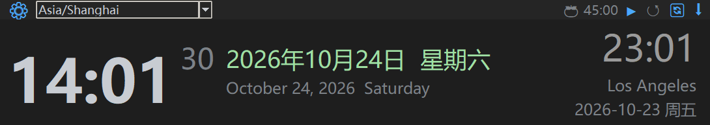
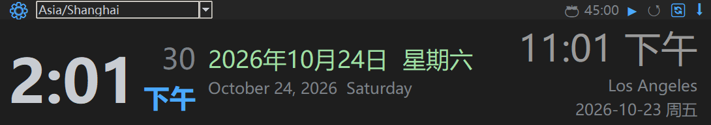

# 🕐 TimeClock i18n — 多时区双语桌面时钟

一个 **无边框、半透明、始终置顶** 的桌面时钟挂件。支持 **598 个时区** 实时切换、**五种工作语言** 双语显示、**全球节假日 + 中国调休** 提醒，以及番茄钟。

> 纯 Python + tkinter，**零前端依赖**，一个文件即可运行。

---

## 功能特性

| 特性 | 说明 |
|---|---|
| 🌍 **全量时区** | 598 个 IANA 时区，下拉框支持**键盘输入实时过滤**（输入 `tokyo` 回车即可） |
| 🗓 **主副双语日期** | 上面中文 `2026年10月24日 星期六`，下面英文 `October 24, 2026 Saturday` |
| 🎌 **五种语言** | 中 zh / 英 en / 法 fr / 俄 ru / 西 es，主副语言可自由组合，**副语言可关闭** |
| 🔄 **双时区一键互换** | 顶栏 `🔄` 一点，上海 ↔ 洛杉矶 互换（自动记忆） |
| 🎉 **节假日提醒** | 自动识别时区所属国家，节假日暖橙、周末绿色、调休上班单独标记 |
| 🍅 **番茄钟** | 默认 45 分钟，可自定义，结束提示音 + 自动复位 |
| ⌨️ **全局快捷键** | 默认 `Ctrl+Shift+T` 沉底/置顶，**可在设置面板里直接按键修改** |
| 💾 **配置持久化** | 语言、时区、快捷键、窗口位置全部自动保存 |

---

## 截图

| 中英双语日期 | 12 小时制（AM/PM） |
|---|---|
|  |  |

---

## 运行要求

- **Python 3.9+**（用到 `zoneinfo`）
- 需要第三方库：`holidays`、`chinesecalendar`、`tzdata`

```bash
pip install -r requirements.txt
```

> `chinesecalendar` 是可选的：只影响中国大陆的"调休上班"标记，缺了也能正常运行。

---

## 快速开始

```bash
# 1. 装依赖
pip install -r requirements.txt

# 2. 运行
python main_i18n.py
```

启动后你会看到一个宽扁的黑色时钟条，默认显示**北京时间**，右侧是**美西时间**。

### 基本操作

| 操作 | 效果 |
|---|---|
| **拖动**任意空白处 | 移动窗口位置 |
| 点顶栏 `⚙` | 打开设置面板 |
| 点顶栏 `⬇` 或按快捷键 | 沉底（不挡视线）／再按回到最前 |
| 点顶栏 `🔄` | 主副时区互换 |
| 点顶栏时区框并打字 | 实时过滤时区，回车切换 |
| `Esc` | 关闭窗口 |

---

## 配置文件在哪

配置**自动生成**，无需手动创建。首次运行后打开：

| 系统 | 路径 |
|---|---|
| **Windows** | `%APPDATA%\TimeClockI18n\config.json` |
| **Linux** | `~/.config/TimeClockI18n/config.json` |
| **macOS** | `~/Library/Application Support/TimeClockI18n/config.json` |

Windows 上直接在资源管理器地址栏粘贴 `%APPDATA%\TimeClockI18n` 即可。

### 全部可配置项

```json
{
  "version": 1,
  "tz": "Asia/Shanghai",                  // 主时区
  "tz2": "America/Los_Angeles",           // 副时区；填 null 表示不显示
  "primary": "zh",                        // 主语言：zh / en / fr / ru / es
  "secondary": "en",                      // 副语言；填 null 表示不显示
  "hour24": true,                         // false = 12 小时制（带 AM/PM）
  "work_minutes": 45,                     // 番茄钟专注时长（1–180）
  "hotkey": "ctrl+shift+t",               // 全局快捷键；"" = 不启用
  "window": { "x": 1580, "y": 40 }        // 窗口位置，程序自动维护
}
```

> 改完保存后**重启程序**生效（快捷键例外，在面板里改是立刻生效的）。
> 删掉这个文件 = 恢复出厂设置。

---

## 如何修改全局快捷键

### 方式一：设置面板里直接按（推荐）

1. 点顶栏 `⚙` 打开设置
2. 找到 **「全局快捷键」** 那一行
3. **点一下输入框**，它会变成 `按下组合键…`
4. **直接按下你想要的组合键**，比如 `Ctrl+Alt+K`
5. 松手就生效并自动保存，无需重启

小技巧：

- 按 `Backspace` 或 `Delete` → **清空 = 禁用**全局快捷键
- 按 `Esc` → 放弃本次修改

### 方式二：手动编辑配置文件

```json
{
  "hotkey": "ctrl+alt+k"
}
```

写法要求：

- 全小写，用 `+` 连接
- 修饰键只能是 `ctrl` / `shift` / `alt` / `win`
- 主键只能是**一个字母或数字**
- 空字符串 `""` 表示不启用
- 格式不对会自动退回默认值 `ctrl+shift+t`

示例：`"ctrl+shift+t"`、`"ctrl+alt+k"`、`"alt+1"`、`"win+z"`

### ❗ 快捷键被其他软件占用了怎么办

这是最常见的问题。**当快捷键注册失败时，程序会自动降级为"按键轮询"模式**——功能照常可用，只是响应稍慢一点，不会报错。

如果连轮询都不灵，或者你想彻底换一个键：

1. 打开 `config.json`，把 `"hotkey"` 改成一个罕见的组合，例如
   ```json
   { "hotkey": "ctrl+alt+shift+k" }
   ```
2. 保存后重启程序
3. 还冲突就继续换，或者干脆设成 `""` 关掉它，改用顶栏的 `⬇` 按钮

> 常见被占用的组合：`Ctrl+Shift+1`（微信截图）、`Ctrl+Alt+A`（QQ 截图）、
> `Win+Shift+S`（系统截图）、`Ctrl+Space`（输入法切换）。
> **建议避开这些。**

---

## 如何切换语言

### 图形界面

`⚙` → **主语言** 下拉选择（中/英/法/俄/西），**副语言** 可选五种语言或「（不显示）」。

- **主语言**决定：日期格式、星期、界面按钮文字
- **副语言**决定：日期下面那一行的语言、节假日的第二种写法
- 副语言设为「（不显示）」→ 中间列只留一行日期

### 配置文件

```json
{ "primary": "zh", "secondary": "en" }
```

想要纯中文单语界面：

```json
{ "primary": "zh", "secondary": null }
```

---

## 打包成 exe（可选）

```bash
python -m PyInstaller --noconfirm --clean --noconsole --onedir ^
  --name TimeClock ^
  --collect-data tzdata ^
  --collect-all holidays ^
  --collect-all chinese_calendar ^
  main_i18n.py
```

产物在 `dist/TimeClock/`，双击 `TimeClock.exe` 即可运行。
打包后的程序和源码**共用同一份配置文件**。

---

## 常见问题

**Q：窗口太小 / 字太小，想调大？**
改 `main_i18n.py` 顶部的常量即可：

```python
WIN_WIDTH   = 1090     # 窗口宽度
SIZE_HHMM   = 46       # 大时间字号（主要看这个）
SIZE_DATE   = 18       # 日期字号
```

> 注意：程序开启了 DPI 感知，标签高度 ≈ 字号 × 2.78（150% 缩放屏）。

**Q：节假日不显示？**
检查三件事：① 该时区是否在 `TZ_TO_COUNTRY` 表里；② `holidays` 是否装了；
③ 这一天该国确实没节日。查不到节日时会安静地不显示，不会报错。

**Q：中国的"调休上班"没出来？**
需要装 `chinesecalendar`，且只能覆盖它支持的年份（目前到 2026 年）。

**Q：窗口跑到屏幕外面了？**
删掉 `config.json` 里的 `"window"` 字段，重启会回到默认位置。

**Q：卡在任务栏没有图标 / 找不到窗口？**
点顶栏 `⬇` 沉底后窗口会在所有窗口下方。按全局快捷键或点任务栏里的 Python 进程即可叫回。

---

## 隐私说明

- 本程序**不联网**、**不上传任何数据**
- 代码中**没有任何硬编码的 API Key、账号或本地路径**
- 所有配置只存在你本机的 `config.json` 里

---

## License

MIT
