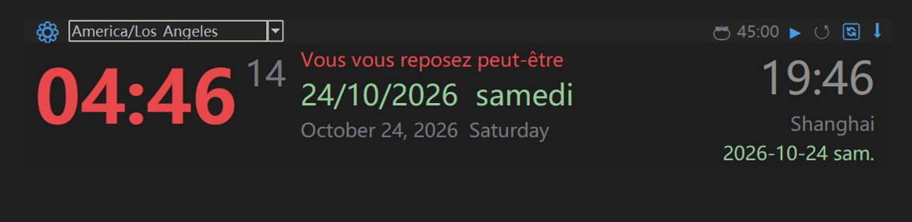

# 🕐 TimeClock i18n — 多时区双语桌面时钟 / Multi-timezone Bilingual Desktop Clock

[](https://www.python.org/)
[]()
[]()

一个**无边框、半透明、始终置顶**的桌面时钟挂件。支持 **598 个时区** 实时切换、**五种工作语言** 双语显示、**全球节假日 + 中国调休** 提醒，以及番茄钟。

纯 Python + tkinter，**零前端依赖**，一个文件即可运行。

A **frameless, translucent, always-on-top** desktop clock widget. Supports **598 IANA time zones**, **five working languages** with dual-language display, **worldwide holidays + Chinese makeup workdays**, and a pomodoro timer.

Pure Python + tkinter — **no frontend dependencies**, runs from a single file.

---

## 📸 截图 / Screenshots

| 中英双语日期 / Chinese + English dates | 12 小时制 / 12-hour clock with AM/PM | 
|---|---|
|  |  |

| 🚨 跨时区休息提醒 / Rest Alert |
|---|
|  |

---

## ✨ 功能特性 / Features

| 特性 / Feature | 说明 / Description |
|---|---|
| 🌍 **全量时区 / All time zones** | 598 个 IANA 时区，下拉框支持**键盘输入实时过滤**（输入 `tokyo` 回车即可）<br>598 IANA zones; the dropdown filters **as you type** (`tokyo` + Enter) |
| 🗓 **主副双语日期 / Dual-language dates** | 上面中文 `2026年10月24日 星期六`，下面英文 `October 24, 2026 Saturday`<br>Chinese on top, English underneath |
| 🎌 **五种语言 / Five languages** | 中 zh / 英 en / 法 fr / 俄 ru / 西 es，主副语言自由组合，副语言可关闭<br>zh / en / fr / ru / es, freely combinable; the secondary language can be turned off |
| 🔄 **双时区一键互换 / One-click swap** | 顶栏 `🔄` 一点，上海 ↔ 洛杉矶 互换（自动记忆）<br>Click `🔄` in the top bar to swap the two zones (remembered) |
| 🎉 **节假日提醒 / Holiday alerts** | 自动识别时区所属国家；节假日暖橙、周末绿色、调休上班单独标记<br>Country inferred from the time zone; holidays orange, weekends green, makeup workdays flagged |
| 🍅 **番茄钟 / Pomodoro** | 默认 45 分钟，可自定义，结束提示音 + 自动复位<br>45 min by default, configurable, with sound and auto-reset |
| ⌨️ **全局快捷键 / Global hotkey** | 默认 `Ctrl+Shift+Alt+T` 沉底/置顶，**可在设置面板里直接按键修改**<br>Default `Ctrl+Shift+Alt+T` to sink/raise; **rebind by pressing keys in Settings** |
| 💾 **配置持久化 / Persistence** | 语言、时区、快捷键、窗口位置全部自动保存<br>Language, zones, hotkey and window position are all saved automatically |

---

## 📦 运行要求 / Requirements

- **Python 3.9+**（用到 `zoneinfo` / requires `zoneinfo`）
- 需要第三方库 / Third-party packages: `holidays`, `chinesecalendar`, `tzdata`

```bash
pip install -r requirements.txt
```

> `chinesecalendar` 是可选的：只影响中国大陆的"调休上班"标记，缺了也能正常运行。
> `chinesecalendar` is optional — it only powers the Chinese mainland "makeup workday" flag.

---

## 🚀 快速开始 / Quick Start

```bash
# 1. 装依赖 / install deps
pip install -r requirements.txt

# 2. 运行 / run
python main_i18n.py
```

启动后你会看到一个宽扁的黑色时钟条，默认显示**北京时间**，右侧是**美西时间**。
You'll see a wide, flat dark clock strip — **Beijing time** by default, with **US West** on the right.

### 基本操作 / Basic Controls

| 操作 / Action | 效果 / Result |
|---|---|
| **拖动**任意空白处<br>**Drag** anywhere blank | 移动窗口位置 / move the window |
| 点顶栏 `⚙`<br>Click `⚙` | 打开设置面板 / open Settings |
| 点顶栏 `⬇` 或按快捷键<br>Click `⬇` or press the hotkey | 沉底 / 再按回到最前<br>sink / press again to raise |
| 点顶栏 `🔄`<br>Click `🔄` | 主副时区互换 / swap the two zones |
| 点时区框并打字<br>Click the zone box and type | 实时过滤时区，回车切换<br>filter live, press Enter to apply |
| `Esc` | 关闭窗口 / quit |

---

## ⚙️ 配置文件在哪 / Where the config lives

配置**自动生成**，无需手动创建。首次运行后打开：
The config file is **generated automatically**. After the first run:

| 系统 / OS | 路径 / Path |
|---|---|
| **Windows** | `%APPDATA%\TimeClockI18n\config.json` |
| **Linux** | `~/.config/TimeClockI18n/config.json` |
| **macOS** | `~/Library/Application Support/TimeClockI18n/config.json` |

Windows 上直接在资源管理器地址栏粘贴 `%APPDATA%\TimeClockI18n` 即可。
On Windows, paste `%APPDATA%\TimeClockI18n` into the Explorer address bar.

### 全部可配置项 / All options

```json
{
  "version": 1,
  "tz": "Asia/Shanghai",                  // 主时区 / primary zone
  "tz2": "America/Los_Angeles",           // 副时区；null = 不显示 / null hides it
  "primary": "zh",                        // 主语言：zh / en / fr / ru / es
  "secondary": "en",                      // 副语言；null = 不显示 / null hides it
  "hour24": true,                         // false = 12 小时制（带 AM/PM）
  "work_minutes": 45,                     // 番茄钟时长 1–180 / pomodoro minutes
  "hotkey": "ctrl+shift+t",               // 全局快捷键；"" = 不启用 / "" disables
  "window": { "x": 1580, "y": 40 }        // 窗口位置（自动维护）/ window position
}
```

> 改完保存后**重启程序**生效（快捷键例外，在面板里改是立刻生效的）。
> Save and **restart** to apply — except the hotkey, which applies instantly from the panel.
> 删掉这个文件 = 恢复出厂设置。Delete the file to restore defaults.

---

## ⌨️ 如何修改全局快捷键 / Changing the global hotkey

### 方式一：设置面板里直接按 / Option 1 — press keys in Settings（推荐 / recommended）

1. 点顶栏 `⚙` 打开设置 / click `⚙`
2. 找到 **「全局快捷键」** 那一行 / find the **Global hotkey** row
3. **点一下输入框**，它会变成 `按下组合键…` / **click the field**, it shows `Press keys…`
4. **直接按下你想要的组合键**，比如 `Ctrl+Alt+K` / **press your combo**, e.g. `Ctrl+Alt+K`
5. 松手就生效并自动保存，无需重启 / released = applied and saved, no restart needed

小技巧 / Tips：
- 按 `Backspace` 或 `Delete` → **清空 = 禁用** / clears it = **disabled**
- 按 `Esc` → 放弃本次修改 / cancel

### 方式二：手动编辑配置文件 / Option 2 — edit the config file

```json
{ "hotkey": "ctrl+alt+k" }
```

写法要求 / Format rules：
- 全小写，用 `+` 连接 / lowercase, joined with `+`
- 修饰键只能是 `ctrl` / `shift` / `alt` / `win` / modifiers are limited to those four
- 主键只能是**一个字母或数字** / the main key must be **a single letter or digit**
- 空字符串 `""` 表示不启用 / `""` disables the hotkey
- 格式不对会自动退回默认值 `ctrl+shift+t` / invalid values fall back to the default

示例 / Examples：`"ctrl+shift+t"`、`"ctrl+alt+k"`、`"alt+1"`、`"win+z"`

### ❗ 快捷键被其他软件占用了怎么办 / Hotkey conflict?

这是最常见的问题。**当快捷键注册失败时，程序会自动降级为"按键轮询"模式**——功能照常可用，只是响应稍慢一点，不会报错。
The most common issue. **If registration fails, the app silently falls back to key polling** — it still works, just marginally slower, and never errors out.

如果连轮询都不灵，或者你想彻底换一个键 / If polling isn't enough, or you simply want a different key：
1. 打开 `config.json`，把 `"hotkey"` 改成一个罕见的组合 / change it to something rare
   ```json
   { "hotkey": "ctrl+alt+shift+k" }
   ```
2. 保存后重启程序 / save and restart
3. 还冲突就继续换，或设成 `""` 关掉它，改用顶栏的 `⬇` 按钮 / keep trying, or set `""` and use the `⬇` button

> 常见被占用的组合 / Commonly taken: `Ctrl+Shift+1`（微信 / WeChat）、`Ctrl+Alt+A`（QQ）、
> `Win+Shift+S`（系统截图 / Windows snippet）、`Ctrl+Space`（输入法 / IME）。
> **建议避开这些。/ Avoid these.**

---

## 🌐 如何切换语言 / Switching languages

### 图形界面 / GUI

`⚙` → **主语言 / Primary** 下拉选择，**副语言 / Secondary** 可选五种语言或「（不显示）」/ pick from five languages or `(none)`。

- **主语言**决定：日期格式、星期、界面按钮文字<br>**Primary** controls the date format, weekday names and UI labels
- **副语言**决定：日期下面那一行的语言、节假日的第二种写法<br>**Secondary** controls the second date line and the second holiday name
- 副语言设为「（不显示）」→ 中间列只留一行日期<br>Set to `(none)` → only one date line remains

### 配置文件 / Config file

```json
{ "primary": "zh", "secondary": "en" }
```

想要纯中文单语界面 / For a Chinese-only UI：

```json
{ "primary": "zh", "secondary": null }
```

---

## 📦 打包成 exe（可选）/ Packaging (optional)

```bash
python -m PyInstaller --noconfirm --clean --noconsole --onedir ^
  --name TimeClock ^
  --collect-data tzdata ^
  --collect-all holidays ^
  --collect-all chinese_calendar ^
  main_i18n.py
```

产物在 `dist/TimeClock/`，双击 `TimeClock.exe` 即可运行。打包后的程序和源码**共用同一份配置文件**。
Output lands in `dist/TimeClock/` — double-click `TimeClock.exe`. The packaged app and the source **share the same config file**.

---

## ❓ 常见问题 / FAQ

**Q：窗口太小 / 字太小，想调大？** / **Q: The window or text is too small?**
改 `main_i18n.py` 顶部的常量 / edit the constants at the top of `main_i18n.py`：

```python
WIN_WIDTH   = 1090     # 窗口宽度 / window width
SIZE_HHMM   = 46       # 大时间字号 / big clock font size
SIZE_DATE   = 18       # 日期字号 / date font size
```

> 注意：程序开启了 DPI 感知，标签高度 ≈ 字号 × 2.78（150% 缩放屏）。
> Note: DPI awareness is enabled, so label height ≈ font size × 2.78 at 150% scaling.

**Q：节假日不显示？** / **Q: No holidays shown?**
检查三件事：① 该时区是否在 `TZ_TO_COUNTRY` 表里；② `holidays` 是否装了；③ 这一天该国确实没节日。
Check three things: ① is the zone in `TZ_TO_COUNTRY`; ② is `holidays` installed; ③ does that country actually have a holiday that day.

**Q：中国的"调休上班"没出来？** / **Q: Chinese makeup workdays missing?**
需要装 `chinesecalendar`，且只能覆盖它支持的年份（目前到 2026 年）。
Requires `chinesecalendar`, and only covers the years it ships (up to 2026 for now).

**Q：窗口跑到屏幕外面了？** / **Q: The window is off-screen?**
删掉 `config.json` 里的 `"window"` 字段，重启会回到默认位置。
Delete the `"window"` field in `config.json`; it returns to the default position on restart.

**Q：沉底后找不到窗口了？** / **Q: Lost the window after sinking it?**
按全局快捷键即可叫回；或点任务栏里的 Python 进程 / press the global hotkey, or click the Python process in the taskbar.

---

## 🔒 隐私说明 / Privacy

- 本程序**不联网**、**不上传任何数据** / **No network access, no telemetry**
- 代码中**没有任何硬编码的 API Key、账号或本地路径** / **No hardcoded API keys, accounts or local paths**
- 所有配置只存在你本机的 `config.json` 里 / All settings live in your local `config.json`

---

## 📄 License

MIT